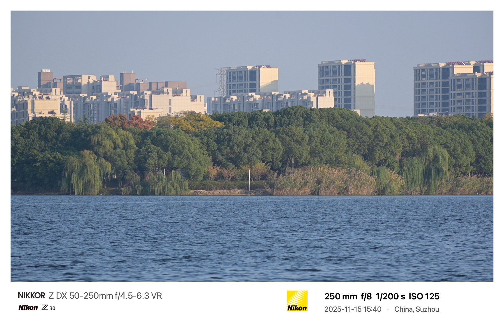
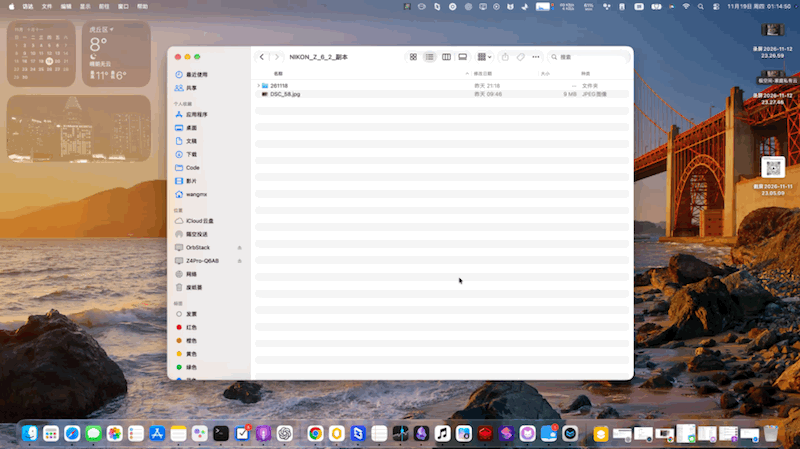

# 尼康相框水印（Nikon Frame Watermark）

一个 macOS「快捷指令 / 快速操作」：给照片加上相框式水印，在底部信息栏显示 EXIF 参数、英文拍摄地点、镜头与机身 logo，适合批量处理后分享。

## 效果预览

> 示例成片：底部信息栏依次展示镜头品牌 logo、尼康机身型号标、Nikon logo，以及焦距/光圈/快门/ISO 和英文地点。

## 功能特性

- 相框式水印：白边 + 底部信息栏，非破坏性输出（原图不做任何改动）
- EXIF 参数：焦距、光圈、快门、ISO、拍摄时间
- 英文地点：根据 GPS 反地理编码为「国家, 城市」；城市州（新加坡、摩纳哥、梵蒂冈等）只显示城市名
- 镜头品牌 logo：NIKKOR、适马、腾龙、唯卓仕、铭匠、七工匠、老蛙、三阳、思锐、美科、福伦达、图丽（支持英文与中文别名识别）
- 尼康机身 logo：按型号区分（Z6 II、Z30，以及其他 Z 系列）
- 保留完整 EXIF / TIFF / GPS 元数据；原有 `UserComment` 保留，并写入 `WATERMARK`
- 色域保留：sRGB、Display P3 原样保留；Adobe RGB / ProPhoto RGB 等「工作色域」统一转为 sRGB，并去掉原来的 ICC 配置
- 防重复水印：文件名以 `-相框` 或 `-相框-数字` 结尾，或 EXIF `UserComment` 含有 `WATERMARK` 的已处理文件自动跳过
- 容错：损坏文件、非图片文件自动跳过，不中断整批处理

## 系统要求

- macOS 11 或更高版本
- 「快捷指令」App（系统自带）
- Xcode 命令行工具（提供 `/usr/bin/swift`；缺失时首次运行会提示安装）

## 安装

1. 到 [Releases](../../releases) 页面下载最新的 `.shortcut` 文件
2. 双击导入到「快捷指令」App
3. 在快捷指令详情中启用「用作快速操作」，并确保「访达」为可用表面
4. 首次运行时按系统提示授权访问照片与定位

## 使用方法

1. 在访达中选中一张或多张照片
2. 右键 → 快速操作 → 尼康相框水印-261119
3. 等待处理完成，输出文件生成在原图同目录，命名为 `原名-相框.jpg`；重名时自动递增为 `-相框-2`、`-相框-3` …

## 使用演示

> 视频为操作过程前 30 秒，以 1.5 倍速、15fps 转成 GIF。

## 输出说明

- 格式：JPEG，质量 0.96
- 元数据：保留原图的 EXIF / TIFF / GPS。原有 `UserComment` 保留，并写入 `WATERMARK`。英文注释的标记在末尾；含非 ASCII 时标记放在前面，避免系统截断后丢掉标记
- 色域：sRGB、Display P3 原样保留；Adobe RGB / ProPhoto RGB 转为 sRGB，并按 sRGB 写出色彩配置
- 地点：照片无 GPS 或离线时，地点行静默留空（不报错）

## 水印元素预览

### 镜头品牌 logo

| 品牌 | Logo |
| --- | --- |
| NIKKOR（尼克尔） |  |
| 适马 Sigma |  |
| 腾龙 Tamron |  |
| 唯卓仕 Viltrox |  |
| 铭匠 TTArtisan |  |
| 七工匠 7Artisans |  |
| 老蛙 Laowa |  |
| 三阳 Samyang |  |
| 思锐 Sirui |  |
| 美科 Meike |  |
| 福伦达 Voigtländer |  |
| 图丽 Tokina |  |

### 尼康机身型号标（左下角）

| 型号 | 标 |
| --- | --- |
| Z6 II（Z62） |  |
| Z30 |  |
| 其他 Z 系列 |  |

### Nikon logo

- 底部栏大 logo：
- 机身型号前小 logo：

## 仓库文件

| 文件 / 目录 | 说明 |
| --- | --- |
| `尼康相框水印-脚本.sh` | 内嵌的 shell + Swift 完整源码 |
| `assets/` | README 展示用的效果图与各品牌 logo |
| `LICENSE` | GPL-3.0 许可证 |

> 可直接导入的 `.shortcut` 文件不存放在仓库中，请到 [Releases](../../releases) 页面下载。

## 已知问题 / 注意事项

- 每次运行有约 1–3 秒的编译启动开销（`/usr/bin/swift` 现场编译；这是为保持单文件可移植性而有意保留的做法）
- `CLGeocoder` 在 macOS 26+ 已被 Apple 标记为弃用（当前仍可正常使用），后续版本可迁移到 MapKit
- 脚本内嵌了各品牌 logo 的 base64 资源，因此 `.shortcut` 文件约 400KB
- 仅支持 macOS（依赖 shell + Swift），不支持 iOS / iPadOS

## 版本

- `v1.0.0`（2026-11-19，261119）：首个正式发布，包含相框式水印、EXIF 参数与英文地点、镜头/机身 logo、色域保留、防重复水印、容错跳过等完整功能。

## License

本项目采用 [GNU General Public License v3.0（GPL-3.0）](https://www.gnu.org/licenses/gpl-3.0.html) 许可证。完整条款见 [LICENSE](LICENSE)。
